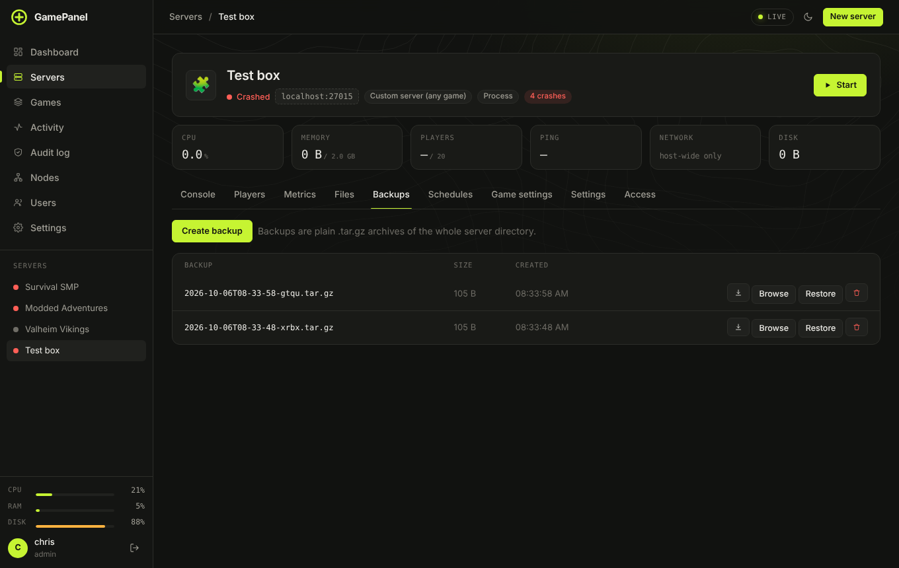

# Backups

A backup is a plain `.tar.gz` of the whole server folder, so you can open it anywhere.

## Making backups

- **By hand:** **Backups → Create backup**.
- **On a timer:** **Schedules → Add task** with **Make a backup**, for example every 6 hours.
- **Automatically:** the panel backs up before risky changes, like switching the Minecraft version or
  resetting a world.

## Restoring

- **Restore** puts the whole server back the way it was. Stop the server first; current files are
  overwritten. Before anything happens, the **restore preview** compares the backup with the server as it
  is now: files that come back (deleted since), files that go back to how they were (changed since) and
  files added since, per folder, with plugin and mod jars and `server.properties` compared by name and
  setting. A normal restore leaves files added since in place; tick **Make it exactly like the backup**
  to delete them too. **Back up the server as it is now first** (on by default) makes the restore undoable.
- **Browse** opens the archive. Tick single files or folders and **Restore selected** to put back only
  those (a broken config, one world) and leave everything else alone. Administrators only.
- The download button saves the archive to your computer.

## Safe updates

On the Backups tab, **Update safely** backs the server up and then updates its game files (Steam and other
updatable games; the server must be stopped). On the Mods tab, **Check updates** has a **Back up first** box
that does the same before mods are updated. The backup is named `…-pre-update-…`, is shown in the
**Safe update** card, and is never removed by backup retention.

If the update went badly, **Roll back to snapshot** puts the whole server back exactly as it was: game
files, configs and worlds, with anything added since removed (player progress since the snapshot is lost too).
The server must be stopped. Nothing is ever rolled back automatically. If automatic game updates are on,
they will update again at their next check, so switch them off for that server first if you want to stay on
the old build. Only the latest snapshot is remembered; older ones are ordinary backups.

## Incremental and encrypted backups

On a server's Backups tab, **Backup type…** switches between *Archive* (a complete `.tar.gz` each time, the default) and *Incremental*. Incremental backups store files as pieces, each piece once: the first backup is full size, later ones only add what changed, and unchanged files are not even read again. Restoring, restoring single files, browsing, checking and downloading (as a `.tar.gz`) all work the same. Cloud copies stay archive-only.

Incremental backups can be encrypted with AES-256. An administrator sets the passphrase under **Settings → Backup encryption**; write it down, because without it encrypted backups cannot be restored on another machine. Changing the passphrase later keeps every encrypted backup readable.

## Checking backups

**Check** on a backup unpacks it into a scratch folder and makes sure every file came back (for incremental backups, every piece is read and verified). Turn on **Settings → Backup checks** to check each backup right after it is made; a failed check sends an alert.

## Test restores

A backup you have never restored is a guess. Settings, **Backup test restores**, proves one: the panel unpacks a server's newest backup (or reads every piece of an incremental or encrypted one) into a scratch folder, compares the file count and sizes, then checks the game's own files: for Minecraft that `level.dat` unpacks and the region files are whole, for Rust that a save and a map are present. The scratch folder is deleted afterwards, only runs when there is disk space for it (otherwise the archive is read end to end), and the last 60 results are kept in a list. Tick **Test each server's newest backup every week** to have it run on its own; a failure raises a "Backup test restore failed" alert (turn it on under Alerts to get it in Discord or on your phone).

## Cloud copies

**Settings → Cloud backups** copies every backup, by hand or scheduled, off this machine so a dead disk
doesn't take your worlds with it. Pick **Copy backups to**: an S3-compatible bucket (Backblaze B2,
Cloudflare R2, Amazon S3, Wasabi, MinIO), Google Drive, Dropbox or an SFTP server. Uploads, the Cloud column,
**Bring back**, delete and **Copies to keep per server** work the same for all of them, and copies are
stored as `<folder>/<server id>/<backup>.tar.gz`.

**Google Drive.** Nothing is shared with anyone: you register your own app. In the Google Cloud console
enable the Drive API, make an OAuth client of type *Web application*, and add the redirect address shown in
the settings. Paste the client ID and secret, **Save**, then **Connect Google Drive** and allow access. The
panel can only see files and folders it created itself.

**Dropbox.** Create your own app in the Dropbox app console (*Scoped access*, *App folder*), enable
`files.content.write` and `files.content.read`, add the redirect address shown in the settings, paste the app
key and secret, then **Connect Dropbox**. Backups go in `Apps/<your app>/<folder>`.

**SFTP.** Host, port, user name and a password or a private key (with its passphrase if it has one). Needs the
OpenSSH client (`sftp`) on the machine running the panel; Linux usually has it and Windows has it as an
optional feature. The server's key is remembered on first use and a changed key is refused. The folder is
relative to the login's home.

Secrets are stored sealed, like the other tokens, and never shown again. **Test connection** works for every
target.

**For S3 buckets:**
1. Make a bucket, and a key that can only reach that bucket.
2. Pick your provider, fill in **Endpoint**, **Bucket**, **Region** (often guessed from the endpoint),
   **Access key ID** and **Secret access key**. **Folder in the bucket** is optional.
3. **Copies to keep per server**: 0 keeps every copy, or let a bucket lifecycle rule expire them.
4. **Test connection** writes, lists and deletes a small file, so you see the bucket's own error if
   something is wrong ([common errors](../troubleshooting.md#cloud-backups)).

After that the Backups tab gets a **Cloud** column. **Copy** retries an upload that failed. Backups that
are **Only in the cloud** have **Bring back**, which downloads them to the panel so you can restore them
like any other. Failed uploads are posted to your alerts when that alert is ticked.

## Copies on another node

**Settings → Backup copies on another node** sends every new archive backup to one of your
[nodes](nodes.md), another machine running GamePanel. Nothing to sign up for, and losing this machine
does not lose the backups. Pick the node and how many copies to keep per server. The Backups tab then
gets a column named after the node, with **Copy** for backups made before it was on, and lists copies
that are **Only on** the node with **Bring back** and delete. The node keeps them as plain `.tar.gz` files
in `backups-from-nodes` inside its data folder, and refuses a copy that would leave it with less than
1 GB free. Incremental backups are not copied.

## Backing up the panel itself

**Settings → System → Back up panel settings** downloads every account, setting, key and the player
history (not server files). Keep it somewhere safe: it holds every key. To restore, stop the panel and
unpack it into the data folder.

## Disk space

**Settings → Limits → Max storage** stops new backups when servers and backups together would go over
it. See [Limits](panel-settings.md#limits).
