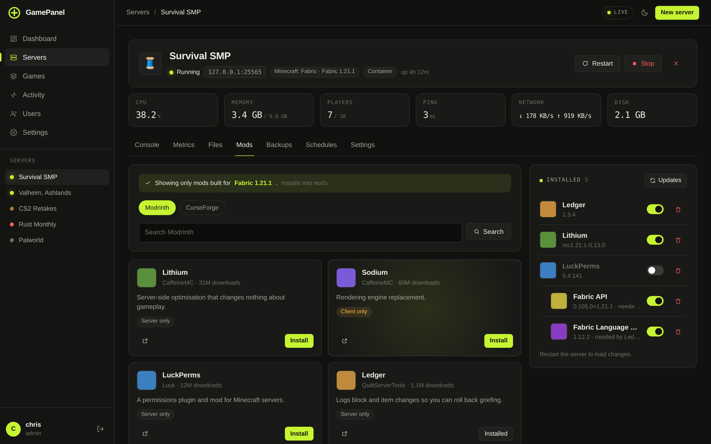
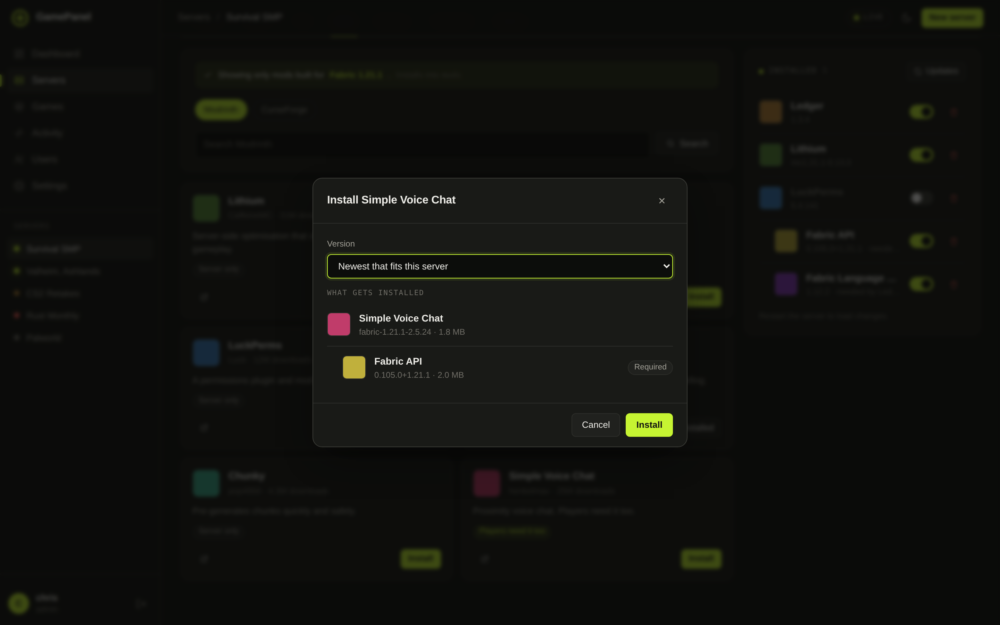
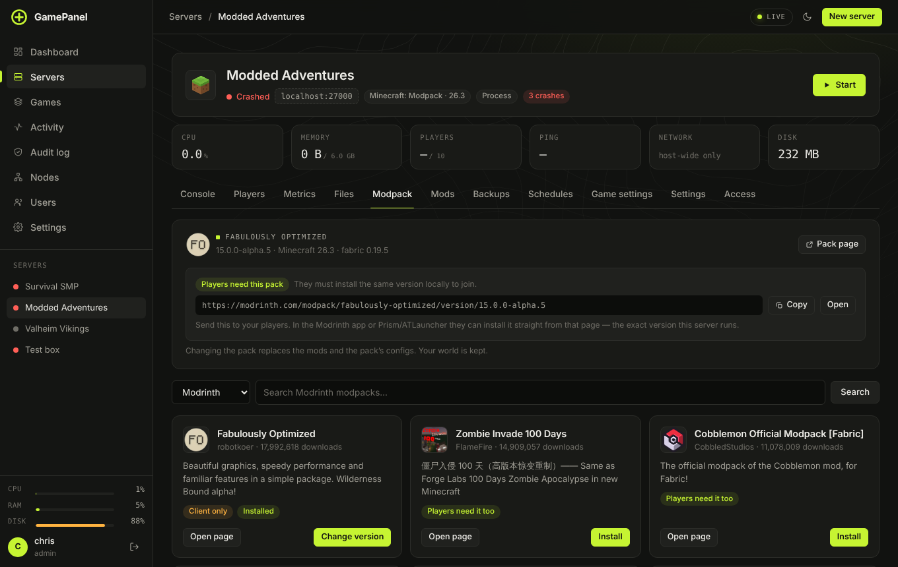

# Mods and modpacks

## Where mods come from

| Game | Sources |
|---|---|
| Minecraft Paper, Purpur | Modrinth, CurseForge, Hangar and SpigotMC (free plugins) |
| Minecraft Fabric, Quilt, Forge, NeoForge | Modrinth, CurseForge |
| Minecraft modpack servers | Modrinth and CurseForge packs, plus extra mods |
| Rust | uMod / Oxide plugins |
| Garry's Mod, ARK, Project Zomboid, Unturned, Arma 3, DayZ, Conan Exiles, tModLoader, Space Engineers, Don't Starve Together, Killing Floor 2, Avorion | Steam Workshop |
| Factorio | The Factorio mod portal |

CurseForge needs a free API key (from console.curseforge.com) under **Settings → Integrations**. Factorio
needs your Factorio username and token there. The others work with no key.

## Installing mods

Open the server's **Mods** tab, search on the left and press install.

- **Only compatible mods are listed.** A Fabric 1.21.1 server sees Fabric builds for 1.21.1; a Forge server
  never sees Fabric mods. NeoForge 1.20.1 also gets Forge builds, since that version loads them.
- **You see the plan first:** the mod and every dependency it pulls in, downloaded together.

  

- **Client-only mods are refused**, because one of them can stop a Forge server from booting. Mods
  players need too are labelled, so you know what to tell them.
- **Updates stay compatible:** **Updates** only offers newer releases for the same loader and version. A
  schedule can run **Update mods and plugins** for you.
- **Removing cleans up:** dependencies nothing else needs go with the mod. The switch next to a mod disables it and
  keeps the file.

Restart the server to load changes.

**Steam Workshop** works per game: Garry's Mod addons are unpacked, Unturned and ARK get the item added to
their own mod lists, Project Zomboid gets `WorkshopItems` and `Mods` written for you, Killing Floor 2 gets
`ServerSubscribedWorkshopItems` lines in KFEngine.ini (start the server once first), and Avorion gets the item in
the galaxy's modconfig.lua. Paste the
Workshop link or item ID and press **Add item**.

A **collection link** installs every item in the collection. The panel remembers the collection, so the
player page below can offer a one-click **Subscribe** link to it.

## Mods for players

Players of modded games need some of the mods on their own computer. In the Mods tab, the **Mods for
players** card turns on a public page (`/mods/<link>`) for that server. It shows only mod names, versions and
links, and nothing about the server itself:

- **Minecraft (Fabric, Quilt, Forge, NeoForge):** the mods players need, split into required and optional (server-only mods
  are left out), and a **Download modpack (.mrpack)** that opens in the Modrinth app or Prism Launcher and
  installs the right Minecraft, loader and mod versions. Only Modrinth mods go in the pack; CurseForge mods
  are listed with links.
- **Steam Workshop games:** the collections you added, with a **Subscribe** link, and every item with its Steam link.
- **Any game:** a note for players and extra links (a resource pack, a launcher, a download), plus **Copy list**
  and **Download list (.txt)** for sharing in Discord.

**New link** (the refresh button) makes the old link stop working. Plugin-based servers such as Paper need nothing on
the player's side, so their page says so.

## Datapacks

Every Minecraft Java server (vanilla, Paper, Fabric, Forge and the rest) has a **Datapacks** card on
its Game settings tab, for the loaded world's `datapacks` folder. **Browse** searches Modrinth for packs
with a release for the server's version; **Upload zip** adds your own (the panel tells you when
`pack.mcmeta` sits in an extra folder, or when the zip is a mod). Each pack can be turned off without
deleting it. Packs made for another Minecraft version are marked **Other version**, using the data pack
format from the server jar itself. On a running server changes apply at once through `/datapack` and
`/reload` (`minecraft:reload` on Paper, so plugins are not reloaded); otherwise on the next start.
**Updates** checks the Modrinth ones for newer releases.

## Resource pack hosting

The **Resource pack** card on the Game settings tab (Minecraft Java) hosts a pack for you. **Upload zip** (up to 250 MB,
with `pack.mcmeta` at the top) and the panel serves it at a private link, then writes `resource-pack`,
`resource-pack-sha1`, `require-resource-pack` and `resource-pack-prompt` into `server.properties`. Players get it on
their next join after the server restarts. Tick **Players must accept** to kick those who decline, and add a message
shown in Minecraft's download prompt. The link serves only that one file; the refresh button makes a new one.

If you opened the panel on `localhost` or a LAN address, set **Panel address players reach** to the public one
(for example `https://panel.example.com`), or players outside your network cannot download the pack.
Replacing the zip updates the hash automatically. Removing the pack clears the keys again.

## The mod check

The Mods tab reads what your mods say about themselves and flags what will stop the server or leave a mod unloaded. It runs whenever you open the tab, on demand with **Check**, after a modded server crashes, and **every time the server starts**. A start only warns in the console and the activity log; it is never blocked, because the check can be wrong about a mod it does not understand and you know your server better.

| Game | What it looks at |
|---|---|
| Minecraft | Inside the jars, also ones you uploaded by hand: made for another loader or Minecraft version, a required mod missing or too old, mods that break each other, the same mod twice, client-only mods. |
| Rust | The uMod plugins: a plugin that `// Requires:` another that is not installed, the same plugin twice, and plugins with no Oxide or Carbon underneath. |
| Factorio | Each mod zip's `info.json`: missing or too-old dependencies, incompatible mods, a mod made for another Factorio version, duplicates. Mods switched off in `mod-list.json` are left out. |
| Every game | What the panel installed against what is on disk: a mod whose file is gone, and a mod you switched off that another one needs. |

## Config files as forms

The **Configs** tab lists the config files of your plugins and mods (`plugins/…`, `config/…`, BepInEx, Oxide) and shows them as forms: toggles, numbers with their unit, colour pickers, lists, and choices where the file lists the allowed values. Only what you change is rewritten, so comments and layout stay. Every save is kept in config history.

- **Sections** fold open and shut, nested the way the file is. **Expand all** and **Collapse all** are above the list, and a section shows how many of its settings you changed.
- **Find a setting** searches labels, keys and help text, and opens the sections that match.
- **Open as text** takes you to the raw file on the Files tab.

Popular configs get a hand-made layout with plain names, help text and groups: Paper (`paper-global.yml`, `paper-world-defaults.yml`), `bukkit.yml`, `spigot.yml`, EssentialsX, WorldGuard, CoreProtect, Geyser and Rust's Gather Manager. A setting the layout does not know still shows up, under **Other settings**, so a newer plugin version never hides anything.

## Minecraft networks

Create a **Minecraft: Velocity proxy** server, then **Servers → Networks → New network**: pick the proxy and the Paper or Purpur servers behind it (the first is where players land). The panel sets up forwarding on both ends, so players join the proxy's address and move between servers with `/server`, and the servers behind it cannot be joined directly.

## Modpacks

Create a server with the **Minecraft: Modpack** game. Pick **Modrinth** or **CurseForge**, search for the
pack and choose a version. The panel installs the right loader (Fabric, Quilt, Forge or NeoForge), every
mod and the pack's own configs.

Later, the server's **Modpack** tab changes the version or swaps to another pack. Changing the pack
replaces the mods and the pack's configs; **your world is kept**. Stop the server first.

Players need the same pack and version on their own computer to join. The pack's mods are labelled
the same way as above: server only, needed by players too, or client side.

You can still add single mods to a modpack server on its **Mods** tab.

## Thunderstore mods (Valheim, V Rising and other BepInEx games)

Thunderstore is the mod site for games that use the BepInEx loader. On a Valheim or V Rising server, open **Mods**, pick **Thunderstore**, search and install. The panel works out what the mod needs: the first install also adds the BepInEx loader itself, then puts each file where mod managers put it (`BepInEx/plugins/<Owner-Name>/`, with configs in `BepInEx/config`). Installed mods can be switched off (their `.dll` files are renamed to `.dll.old`), updated and removed; a new release never overwrites a config you edited. Restart the server after changing mods.

Not every Thunderstore mod is meant for servers; mods tagged client-side only are refused. The Valheim start line switches BepInEx on by itself once the loader is installed. On Linux, V Rising runs through Wine and the template sets the override BepInEx needs. This was written to Thunderstore's documented format and has not been run against a live game server.

## tShock plugins (Terraria)

tShock is a Terraria server with plugins. It is a separate download from vanilla Terraria: get it from github.com/Pryaxis/TShock/releases and upload it on the **Files** tab. Then the Terraria **Mods** tab can:

- search GitHub for repositories tagged `tshock-plugin` and install their latest release (a `.dll` or a `.zip` holding one),
- install from any `https://` address or an uploaded `.dll`/`.zip` (this needs the file-upload permission),
- switch plugins off (`.dll.disabled`), update and remove them.

tShock's own settings (`tshock/config.json`) show up as a form on the **Configs** tab once the server has started once.

## Nexus Mods links

Games that have no one-click source on the panel (7 Days to Die, Project Zomboid and many more) still get a **Mods** tab with a search box that opens that game's page on nexusmods.com, plus a link to browse all its mods. Download there and upload the files on the Files tab. The panel never talks to Nexus and needs no key.
