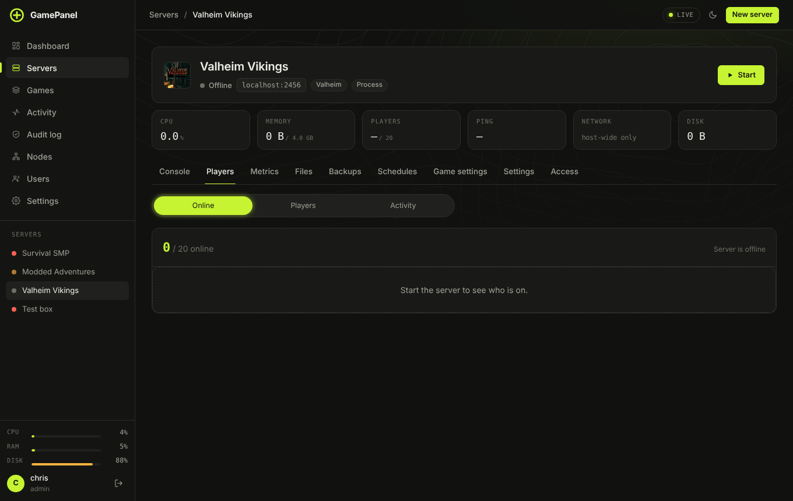
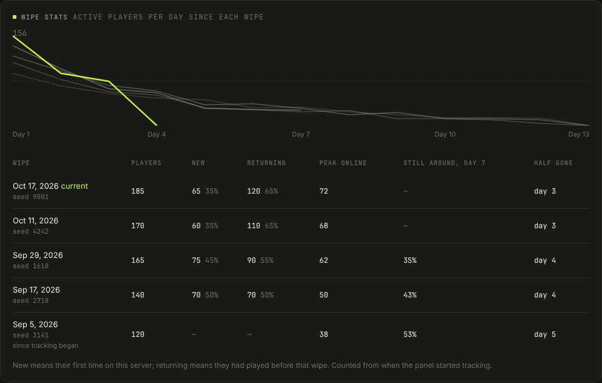

# Players

The **Players** tab on each server has up to four views. What shows depends on what the game reports:
Minecraft, Source games and anything with a query port report the most.

## Online

Who is on right now, for how long, and their score or ping where the game gives it. **Kick** and **Ban**
are next to each name. The online graph above covers the last 24 hours, 7 days or 30 days.

## Players

Everyone who has ever joined: first and last seen, total play time and sessions. Click a name for their
profile:

- **Recent sessions** and their activity on this server.
- **In-game stats** for Minecraft: deaths, kills, distance travelled, most mined blocks, advancements.
- **Addresses** with rough location and alt-account warnings when two players share an address (only
  administrators see this).
- **Inventory** for Minecraft Java: armour, off-hand, inventory, hotbar and ender chest with item
  pictures, enchantments and names, plus health, hunger, level and where they are. **Show** picks a
  backup to see the inventory as it was then, and **Put this inventory back** restores only that
  player's file from the backup (they must be offline; the current file is kept in
  `.gamepanel/player-rollbacks`). Handy after a griefing or a lost-items bug, without rolling back the world.
- **Edit items** opens a real-looking inventory editor (Minecraft Java): armour, off-hand, main slots,
  hotbar and the ender chest as a grid of item tiles. Click a slot (or press Enter) to change the item,
  count, damage, custom name and enchantments, drag a tile onto another slot to move or swap it, use the
  arrow keys to walk between slots, Delete to empty one, and search the list to add items. **Save changes**
  only works while the player is **offline** (the game writes a player's file when they leave, which would
  undo your edit), so kick them first. Everything in the item you did not touch is kept as it was, the old
  file is copied to `.gamepanel/player-rollbacks` first, and the new one is checked before it replaces the
  old. You can edit the ender chest of any player who is offline. Needs the "write files" permission.
- **Skin and head** pictures come from the panel, not your browser: for Java the panel asks Mojang's
  session server, for Bedrock/Floodgate names the Geyser global API (api.geysermc.org), and caches the
  result for hours, so nobody's address is shown to those services. Servers with `online-mode=false`
  have no real accounts, so they show a letter tile instead.
- **Staff note**, and **Alert me when they join any server** to put someone on a watchlist.
- **Ban on all servers** / **Unban everywhere**.

**Popular times** is a heatmap of the average number of players by day and hour over the last 30 days.

**Wipe stats** (Rust, ARK and other games with wipes) shows, for each wipe, how many players showed up, how many were **new** (their first time on the server) and how many were **returning**, the peak online, how many of the first two days' players were still around on day 7, and the day the daily crowd fell to half of its best day. The chart draws active players per day since each wipe, newest wipe in lime. Counting starts when the panel first sees the server, so the first row says *since tracking began*; later wipes (from Schedules or the Wipe button) each start a new row.

## Activity

A log like BattleMetrics: joins, leaves, chat, kicks, bans and restarts, with filters. **CSV** downloads
what's shown.

## Whitelist & bans

For Minecraft Java (whitelist, ops and bans) and Bedrock (allowlist). Changes go through the console
while the server runs and straight into the files while it's stopped.

**Maintenance mode** turns the whitelist on, kicks everyone who isn't an op or whitelisted, and changes
the MOTD and status page. Turning it off puts everything back.

## Chat moderation

**Players → Chat rules** (Minecraft Java): blocked words (matched as whole words, also when written as b4d or b.a.d), links and server addresses (with sites you allow), shouting and spam. Each time a player breaks a rule they go one step up the ladder you set: warn, mute (with EssentialsX, LiteBans, AdvancedBan or CMI; a kick otherwise), kick, ban for a while. Strikes are forgotten after a quiet while, and staff can be left out. Every action is in the activity log.

## Shared bans and appeals

The **Bans** page holds one ban list for every server that can ban players, including servers that are stopped (Minecraft) or come back later. Lifting a ban lifts it everywhere; servers can opt out. Turn on the appeals page and banned players can ask to be let back in at `/appeal`; you accept (which lifts the ban) or deny with a reply.

## Whitelist from Discord roles

On **Whitelist & bans**, *Whitelist from Discord roles* puts members with the roles you pick on the whitelist and takes them off when they lose the role. Players link their Minecraft name with the bot's `/link` command. It needs the Discord bot (Settings) with "Server Members Intent" turned on in the Discord developer portal.

## Find a player anywhere

**Activity** in the sidebar has **Find a player on any server**; administrators can also search by address.
