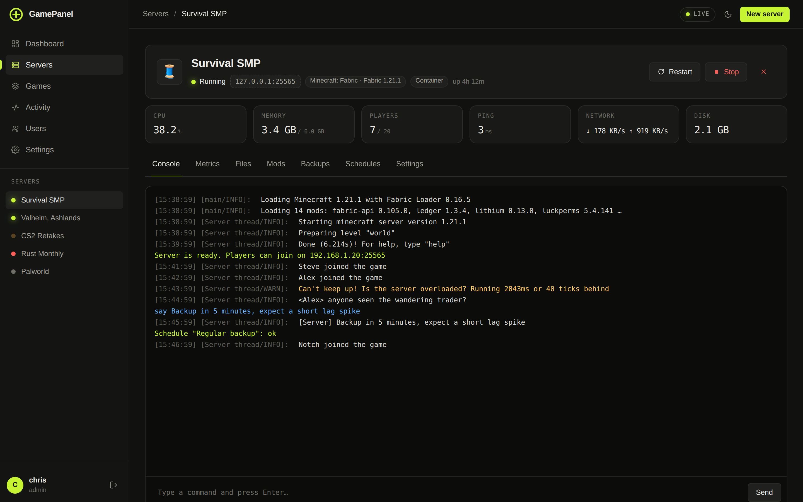
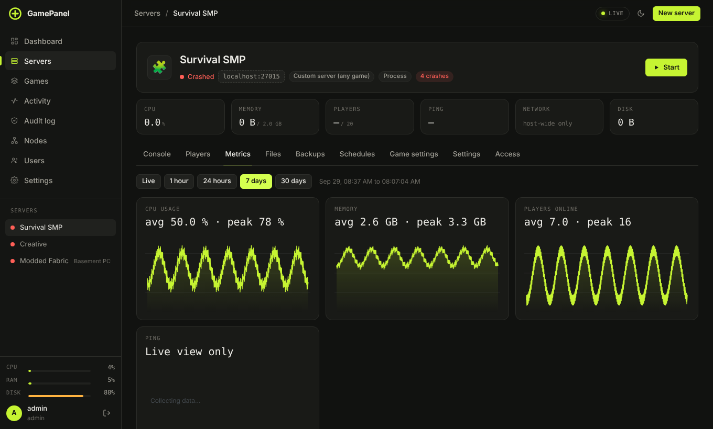
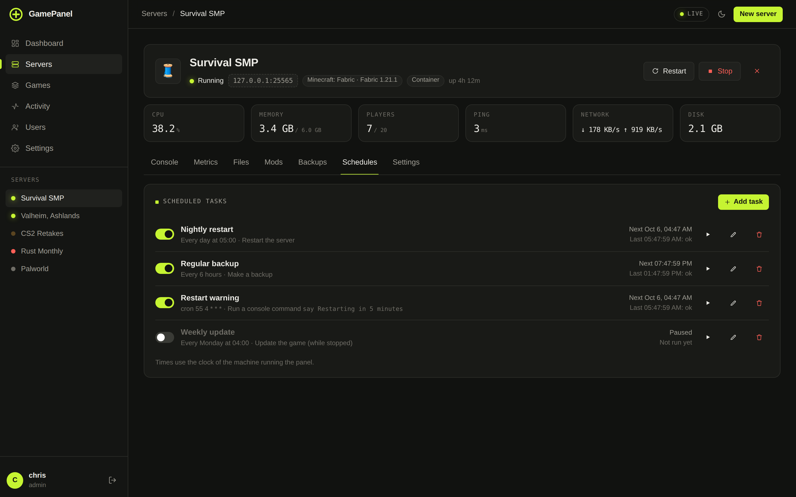
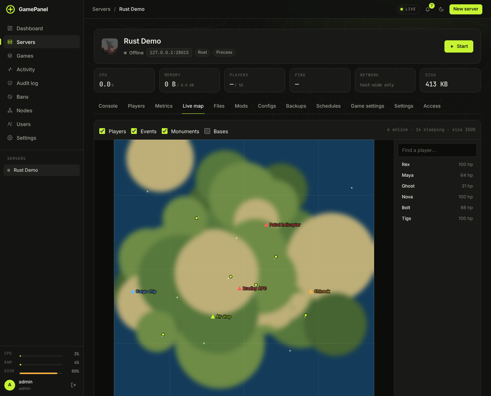

# Running a server

Open a server from the sidebar or **Servers**. The header shows its status, the address to join (click to
copy), the game and version, and live CPU, memory, players and ping. Start, stop and restart are on the
right. Below that are the tabs; you only see the ones your account is allowed to use.

| Tab | |
|---|---|
| **Console** | Live output and commands |
| **Players** | Who is on, history, whitelist and bans. [Players](players.md) |
| **Metrics** | Graphs |
| **Files** | File browser and editor |
| **Modpack** / **Mods** | For games that support them. [Mods and modpacks](mods-and-modpacks.md) |
| **Backups** | [Backups](backups.md) |
| **Schedules** | Restarts, backups and commands on a timer |
| **Game settings** | The game's config as a form, plus versions and worlds for Minecraft |
| **Settings** | Name, memory, ports, alerts, reachability, automatic updates, danger zone |
| **Access** | Who else can use this server. [Users](users-and-2fa.md#sharing-one-server) |

## Console

Output is colour-coded and live. Type a command and press Enter; where the game has RCON the panel uses
it. **↑ / ↓** walks through your command history and **Tab** completes commands and online player
names. Click a player name in the output to open their profile.

**Quick commands** sit above the command line: buttons for the common commands of the game (save, say,
kick, time, weather and so on; Minecraft, Bedrock, Rust, ARK, Palworld, 7 Days to Die, Project Zomboid,
Terraria, Factorio, Unturned, Squad and the Source games such as CS2, TF2 and Garry's Mod). Buttons that
need a player or a message ask for it first, and the panel builds the command itself, so nothing typed
there can add a second command. **＋ Macros** saves your own buttons for this server: each macro is one or
more console commands, one per line, and `@say text` posts to game chat. Running them needs the same
permission as typing a command.

**Autocomplete** suggests commands and their arguments as you type (online player names where the game
needs one), with the command's usage shown underneath. Tab takes the first suggestion; ↑ / ↓ pick another.

**When a server crashes** the console shows the **Crash doctor**: what went wrong in plain words (wrong
Java version, out of memory, EULA not accepted, a broken mod or plugin) with a button that fixes it.
**Share log** uploads the log to mclo.gs so you can send someone a link. Crashed servers restart on
their own unless they crash too often (Settings → General → Max crash restarts).

## Metrics

CPU, memory, players and ping, with a range picker from the last hour up to 30 days. History is kept
per minute for a day and per 15 minutes for 30 days, and survives panel restarts. 100% CPU is one full
core. Paper and Purpur servers also show TPS on the server page.

**Lag report** above the advice finds out what slows the server down:

- **Minecraft** (Paper, Purpur, Folia, Fabric, Quilt, Forge, NeoForge): runs the [spark](https://spark.lucko.me) profiler on the live server for 30 seconds to 5 minutes and shows the link to its report, which breaks the time down by plugin, mod and method. **Quick health report** skips profiling and gives a link to a summary of memory, disk and tick times. If spark is not installed, **Install spark** adds it from Modrinth (restart once to load it). Profile while the lag is happening for the clearest answer.
- **Rust**: asks the server for its frame rate and sets it beside the plugin count and how the machine has been doing. Rust and Oxide have no profiler that can trace a single plugin, so this points at suspects rather than naming one.
- **Other games**: a snapshot of CPU, memory, players and what the console says.

Every report keeps a snapshot of the last 15 minutes (CPU, memory, players, TPS, "can't keep up" lines) with a plain-language reading, so an old spark link can be judged against how the server was doing. Reports are kept in the server's `.gamepanel` folder and travel with backups. Taking one needs the permission to send console commands.

**Advice** under the graphs looks at the memory and player history, crashes, the console, the number of
mods or plugins, TPS and `server.properties`, and says what to change and why: too little memory (or an
out-of-memory crash), more than it needs, more memory promised than the machine has, Aikar's Java flags for
larger Minecraft servers, lag with view and simulation distance, and a CPU that is busy all day.
Administrators can apply memory, setting and flag changes with one click; they take effect on the next start.

## Files

Browse, edit, create, rename and delete; drag files onto the page to upload, and **Unpack** a zip where it
is. **Search** looks through file names and contents. JSON and YAML are checked before saving, so a
typo can't stop the server from starting. **Preview** opens images, textures, 3D models and GTA V files
right in the browser: see [File previews](file-previews.md).

**History** (top right) lists every file saved through the panel: the editor, the Game settings form, the
Configs forms and reverts. Pick a file to see each earlier version compared with the file as it is now, and
**Put this version back** to undo a change (the current content stays in the history too). The first save
of a file also keeps what was there before, and the last 50 versions of each file are kept.

## Schedules

**Scheduled tasks** run on a timer: every day at 05:00, every 6 hours, every hour, or any cron expression
(minute, hour, day of month, month, weekday; the clock is the panel machine's).

| Action | |
|---|---|
| Restart / Stop the server | **Warn players first** posts "restarting in 5 minutes", then 1 minute, 30 and 10 seconds |
| Make a backup | |
| Run a console command | `say Server restarts at 5am` |
| Start the server | |
| Update the game | While it's stopped |
| Update mods and plugins | Only compatible updates |
| Switch settings preset | Applies one of the game's presets (Rust 2x to 10x, ARK rates…), restarting after an optional countdown. Admins only |

Tick **only when empty** to skip a run while people are playing. **Chat announcements** on the same tab
rotate messages in game chat, and can send new players a first-join welcome.

### Preset events (a 2x weekend)

The **Preset event** button on the Schedules tab (games with presets) adds two tasks at once: switch to a preset on a day and time, and switch back on another. For example 2x from Friday 18:00 to Monday 06:00, with a 10 minute chat countdown before each restart. They are ordinary **Switch settings preset** tasks, so edit, pause or delete them like any other. A task that finds the server already on its preset does nothing, and each switch shows in the Game settings history.

### Rust events and teams

Rust's **Game settings** card has an **Events** group and a **Team size** setting.

- **Patrol helicopter, cargo ship, Chinook:** *Vanilla* leaves Rust's own timing alone, *Off* stops them, and a set time (every 30 minutes to every 4 hours) blocks the random spawns and starts one that often instead. These use a small plugin the panel adds to `oxide/plugins` (GamePanelEvents.cs), so they need Oxide. The panel sends the timers each time the server starts. Servers made before this update get the plugin the next time you run **Update**.
- **Bradley APC:** turn it off, or pick how long it takes to return. This uses Rust's own `bradley.enabled` and `bradley.respawndelayminutes`, no plugin.
- **Team size:** Solo, Duo, Trio and Quad set the team limit (1 to 4); *Custom* uses **Max team size**. Turn on **Show team size in server name** to get a tag like `[2x | Duo] My Server` in the server list.

### Rust wipes and maps

Rust servers get a **Wipe** card on the Schedules tab.

- **Wipe now** asks for a **map wipe** (the save, player states and entities go; blueprints stay) or a **full wipe** (blueprints too), can pick a new random seed and update the game first. The server stops, wipes and starts again.
- **Every force-wipe day** adds a scheduled full wipe on the first Thursday of the month at 19:00 (the panel machine's clock; edit it to match your time zone) with a 10 minute chat countdown, a new seed and a game update first. Any other wipe cycle is a "Wipe the map" task with its own time, type and warning.
- The **Map** card picks what the server loads on its next start: a generated map (size and seed from Settings), one of the game's own maps (Barren, Hapis Island, Craggy Island, Savas Island), a link to a hosted `.map` file, or a `.map` you upload (the panel serves it to the game itself). Pick the map, then wipe so the save matches it. A fixed map keeps its layout, so "new seed" does nothing for it.
- **RustMaps** (inside the Map card): a **Preview** button opens the generated map for your size and seed on rustmaps.com, and **Random seed** sets a new seed so you can browse a few before you wipe.
- **Leaving monuments out:** vanilla maps cannot drop monuments, so the panel asks RustMaps to generate a custom map. Add your RustMaps API key under **Settings → Integrations** (it needs a RustMaps subscription with custom map access; each map counts against your allowance), then **Choose monuments to leave out**, tick them and generate. The map is downloaded to the server's `custom-maps` folder and selected; wipe to load it. A combined Outpost and Bandit Town is not something ticks can do: save it as a config on your RustMaps dashboard and pick it from **saved config** in the same panel. Ticking Bandit Town just removes it.
- **Wipe announcements** (Wipe announcements card, administrators): posts to a Discord webhook, or the server's own Discord channel if it has one. A scheduled wipe posts when it starts (with the chat countdown time) and optionally ahead of time, from an hour to a week before; any wipe, scheduled or manual, posts again when it is done. Posts list the map size, seed, wipe type and how to connect, with a RustMaps preview picture when a RustMaps key is set (otherwise a link). Edit the message text with `{server} {when} {type} {size} {seed} {map} {connect}`, choose whether to ping `@here` or `@everyone`, and use **Send a sample** to check it.
- **Live map** (Rust, needs uMod/Oxide; ): see online players, monuments, cargo ship, patrol helicopter, Chinook, Bradley, air drops, locked crates and (optionally) bases on the map, refreshed every few seconds. Open the **Live map** tab, click **Install map plugin** (Oxide loads it at once, no restart) and the dots appear. The panel asks the plugin over RCON, so nothing is exposed to the internet. Scroll to zoom, drag to pan, click a name in the list to jump to a player. The picture comes from RustMaps when a RustMaps key is set (Settings → Integrations), from a custom map the panel generated, or from a PNG/JPEG you upload there; without one you still get a grid with monuments. Positions are sensitive, so only admins and users with that server's console permission can open it; installing the plugin needs file-write permission.
- **Rust tab** (Rust servers): five small tools in one place.
  - **Server card:** name, address, players, map size and seed, last wipe and header image, with a QR code that opens the game and joins the server through Steam. It only shows what any player can already see; no passwords. Rust+ is paired inside the game (menu, Rust+, Pair), so the card only reminds you which port Rust+ needs open.
  - **Presets:** one click loot multipliers (1x, 2x, 3x, 5x or your own number) using the BetterLoot plugin, and stack sizes (2x, 5x, 10x, or a number per item category) using StackSizeController. Click **Install** if the plugin is missing, start the server once so the plugin writes its config, then pick a preset. The panel changes only the multiplier numbers and keeps the rest of the config. Stack changes fully apply after a restart. **Day and night length** sets how many real minutes a day and a night last; it applies at once on a running server and again at every start. Plugin presets were written against the plugins' documented config and have not been run against a live server here; if a plugin's config layout differs, the panel says so instead of guessing.
  - **AFK and ping kick:** off until you turn it on. Every 20 seconds the panel checks players, warns in chat when someone has stood still for your number of minutes (or kept a ping over your limit for several checks), and kicks them if it has not improved when the warning time ends. Owners and moderators are never kicked, and you can list more Steam IDs to leave alone. It needs the live map plugin for standing-still detection.
  - **Teams:** Rust teams with members, who is online and where their bases are; if the Clans plugin is installed its clans are listed too. Needs the live map plugin (update it once from the Live map tab to get teams and entity counts).
  - **Entities:** how many things each player has built, biggest first, with a **heavy** mark on very large builds and a button that copies a console command to teleport you there. Teams and Entities need console permission because they show player positions.
- **Oxide stays current:** a game update puts uMod/Oxide back right after the Rust files are replaced, and the panel checks for new Oxide releases every half hour. When one is out it updates as soon as nobody is playing (automatic updates also cover the game itself, see Panel settings). On force-wipe day Oxide can lag the game by a few hours; plugins load again when its release arrives. Carbon is not installed by the Rust template.

### ARK wild dinos

ARK servers can despawn every wild dino with `DestroyWildDinos` (tamed dinos stay): the **Wild dinos** card on the Game settings tab does it now, and a **Wipe wild dinos** task on the Schedules tab does it on a timer, with an optional chat countdown. Pair it with a daily restart to keep the map's spawns fresh.

## Game settings

The game's own config files (`server.properties` and friends) as a searchable form, with a note on what
each option does. **Restart now** applies changes that need a restart. Minecraft servers also get:

- **Version and type:** switch between Vanilla, Paper, Purpur, Fabric, Quilt, Forge and NeoForge, or another
  Minecraft version. The panel stops the server and backs up first.
- **Worlds:** load another world, import a zip, download, reset with a new seed, delete. It backs up first.
- **Singleplayer world:** zip your world's folder from `.minecraft/saves` (or pick a Bedrock `.mcworld`) and press **Singleplayer world**. The panel finds the world inside the zip however many folders deep it is, unpacks it safely (no path tricks, size limits), and for Paper and Purpur moves the Nether and End into the sibling `world_nether` and `world_the_end` folders that those servers use (Vanilla, Fabric, Forge and NeoForge keep them inside the world folder; you can pick). It can set `level-name` so the server loads it, and if a world with that name exists it backs up the server and moves the old world to `.gamepanel/world-previous` first. The server must be stopped. Paper 1.21.9 and newer may migrate the layout itself on first start; if the Nether looks reset, import again with "inside the world folder".
- **Java flags:** presets for the JVM flags on Minecraft servers: Aikar's flags, generational ZGC for Java 21 to 23 or Java 24+, a low-memory set, a GraalVM set (only starts on GraalVM) and custom flags. Each has a one-line explanation, memory-dependent values are computed from the server's Memory setting, and `-Xms`/`-Xmx` stay managed by that setting. Takes effect on the next start. Administrators only.
- **Permissions (LuckPerms):** if the LuckPerms plugin is installed and the server is running, a card lists groups and players and lets you set weights, parent groups, prefixes and suffixes, meta and permissions (allow or deny, optional `server=`/`world=` context, temporary with a duration) without the external web editor. The panel reads the state with `lp export` (it writes and deletes a temporary file in the plugin folder) and every change is one `lp ...` console command built from checked fields, never from raw text. Needs the "send console commands" permission. Not tested against every LuckPerms version: if the card says the export could not be read, update LuckPerms.
- **Trim the world:** deletes chunks players barely visited (set the minimum time and a protected area around spawn) from the Overworld, Nether or End to shrink the world and its backups. **Preview** shows how many chunks and how much space first; the server must be stopped and a backup is made before anything is deleted. Deleted chunks regenerate from the seed if someone goes there later, so builds in areas nobody "inhabited" long enough are lost. Java Edition only.
- **How it looks in Minecraft:** server icon and coloured MOTD with a live server-list preview.
- **Game rules:** keep inventory, daylight cycle, mob griefing, sleep percentage… Changes apply live.
- **Bedrock crossplay:** one switch installs Geyser, Floodgate and ViaVersion so Bedrock players can join.
- **Live map:** BlueMap on its own port, linked from the status page.
- **Pre-generate the world:** Chunky generates the world ahead of time, with live progress.

## Settings tab

| Card | |
|---|---|
| **General** | Name, memory limit, start command, max players, **stop when empty** after X minutes, **restart when frozen** for X minutes. **History** shows earlier versions of everything on this tab (name, memory, ports, variables…) with a line-by-line comparison and one-click **Put this version back**. Secret variables like a Steam password are never stored in it. |
| **Automatic game updates** | Follow the panel setting, or force on or off for this server. Steam is checked every 30 minutes, and the update waits until nobody is playing. |
| **Alerts** | CPU, memory, folder size and TPS thresholds, posted to your alert webhook |
| **Address** | A name like `play.example.com` through Cloudflare, when it's set up under Settings → Integrations |
| **Discord channel** | Chat, joins and status into a channel, and messages typed there show up in game |
| **Steam server list** | Steam games: checks the server is in the in-game browser and alerts when it drops off. [More](alerts-and-discord.md#steam-server-list-check) |
| **Reachability** | Open the ports in the firewall and on the router. [More](../troubleshooting.md#making-a-server-reachable) |
| **Ports** | Changes apply on the next start |
| **Wake on join** | Minecraft Java, optional: while the server is stopped the panel answers on its port. The server list shows it as asleep, and joining starts it; the player is told to join again in about 30 seconds. Banned players never wake it, and with the whitelist on only whitelisted players do. Goes well with **stop when empty**. |
| **Staging copy** | Make a copy on its own ports (with or without the world) to try plugin and mod updates or new settings. The copy shows **Push to live…**: tick what to bring over (plugins and mods, config folders, `server.properties` without the live ports, the game version) and the live server takes exactly those. Its world, player lists and logs stay, and plugin data in `plugins/` is never overwritten. A backup of live is made first, and a running live server is stopped for the push and started again. |
| **Danger zone** | Duplicate, export, reinstall, delete |

## Servers page

**Start all**, **Stop all** and **Message all** (a chat message to every running server) sit at the
top of **Servers**, next to **Import existing**.

## ARK clusters

**Servers → Clusters → New cluster** links ARK servers (one per map) so players can upload a character, items or dinos at an obelisk or terminal on one map and download them on another.

1. Create the ARK servers first, each on its own map. Evolved and Ascended cannot be mixed.
2. Pick the servers, choose what players may upload and download (characters, items, dinos), and save.
3. Restart the servers. They now share one cluster ID and one folder, kept in the panel's data folder (`clusters/`), mounted into Docker servers automatically.

Only servers on the same machine can join a cluster; servers on another node cannot share its folder. Removing a cluster keeps the uploaded data. The optional timers set how long uploads last before they expire.

## Steam branch (beta builds)

For games installed through SteamCMD, the **Game settings** tab has a **Steam branch** card. "public" is the normal release; games also publish test builds on other branches ("beta", "experimental", "unstable"). Pick one from the list Steam reports, or type its name. Locked branches need a password, which the panel stores encrypted and never shows again. The choice is per server and used by Update, Reinstall and automatic updates. Going back to "public" after a beta may need a reinstall because a beta build can change save formats.

## Project Zomboid sandbox options

On a Project Zomboid server, **Game settings → Sandbox options** edits `<name>_SandboxVars.lua`: zombie speed and population, loot, day length, XP and so on, as a form with a few presets named after the game's difficulties (they are close approximations). The file is read as plain data and never run; only the values you change are rewritten, so comments and order stay. Stop the server first, because the game rewrites the file when it shuts down. The file appears after the server has started once.

## 7 Days to Die map preview

After the first start has generated the world, **Game settings → World map** shows the biome picture with every building marked; hover a dot to see its name. Before that there is nothing to show, because the game builds the world itself on first start: start the server once, then come back. (A preview from a throwaway test world is not offered.)
