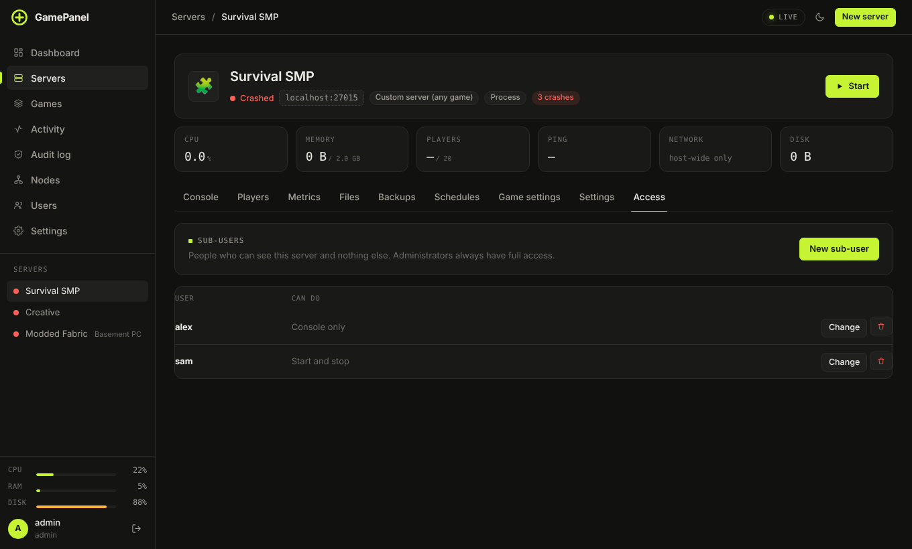
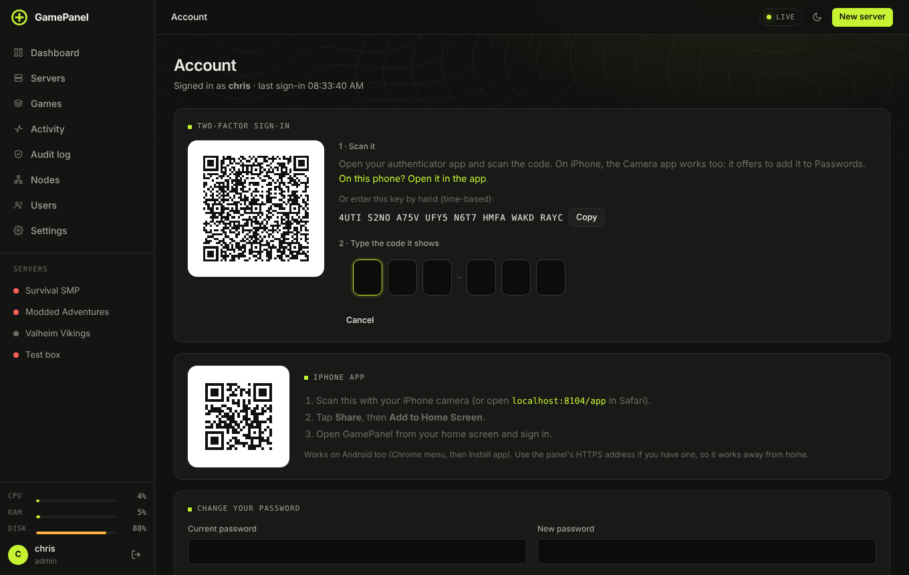

# Users, sub-users and two-factor sign-in

There are two kinds of account:

- **Administrator:** full access to everything, including Settings, Users, Nodes and the audit log.
- **User:** sees only the servers they're given, and can only do what they're allowed to on each.

## Sharing one server

The quickest way to give a friend access is from the server itself: **Access tab → New sub-user** makes
an account that sees that server and nothing else. **Add existing user** gives someone who already has an
account access to this server too.



Pick a preset or tick exactly what they may do:

| Preset | Allows |
|---|---|
| **Console only** | Watch the console and send commands |
| **Start and stop** | Start, stop and restart, and watch the console |
| **Files only** | Browse, download, upload and edit files |
| **Full server access** | Everything on that server: power, console, settings, schedules, files, mods, backups and restores |

The single permissions are: start/stop/restart, view the console, send console commands, edit server
settings (trusted: variables reach the game's command line), manage schedules, browse and download files,
upload/edit/delete files, install and remove mods, create and download backups, restore and delete
backups. Each server can give the same person different permissions. **Change** edits them, and removing
the person takes away only this server.

## The Users page

**Users** lists every account. **New user** creates one with a role. For a user you choose their
**Assigned servers** (hold Ctrl or ⌘ to pick several) and their general permissions, which apply on any
assigned server that has no permissions of its own on the Access tab.

From each row you can **Edit**, **Sign out** (ends all their sessions), **Reset 2FA** and delete.

Only administrators manage accounts, and API keys can never change accounts.

## Two-factor sign-in

Everyone can turn it on for themselves under **Account → Two-factor sign-in** with any authenticator app.
Saving the recovery codes matters: each signs you in once without the phone. **New recovery codes** makes
a fresh set and cancels the old ones.



**Users → Require two-factor for administrators** makes it compulsory for every admin (turn it on for your
own account first). It covers the live connection to the panel too, not just the sign-in page.

Locked out? Another administrator can press **Reset 2FA** for you, or see
[Locked out by two-factor sign-in](../troubleshooting.md#locked-out-by-two-factor-sign-in) to turn it off
from the machine.

## Passkeys

A passkey lets you sign in with the lock you already use on your device: Windows Hello (face, fingerprint or PIN), Touch ID or Face ID on a Mac or iPhone, Android fingerprint or screen lock, or a USB/NFC security key. No password is typed and the secret never leaves the device.

Set one up on the Account page, under **Passkeys**:

1. Open the panel at its **HTTPS address, at a name** (like `panel.example.com`, or `localhost`). Browsers refuse passkeys on plain HTTP and on IP addresses; the page tells you if that is the problem. See [HTTPS](panel-settings.md#https).
2. Click **Set up with Windows Hello** (it says Touch ID / Face ID or "this device" on other systems). Enter your password, name the passkey, and approve the prompt from your device.
3. Or click **Add a security key** for a USB/NFC key and touch it when it blinks.

If the prompt never appears or the browser says the device cannot make a passkey, Windows Hello is probably not set up: open Windows Settings, Accounts, Sign-in options and add a PIN or face/fingerprint. On a Mac or phone, turn on a screen lock or Touch ID / Face ID.

To sign in, click **Sign in with a passkey** on the sign-in page, or just click the username box and pick your passkey from the suggestions the browser shows (autofill). No username is needed: the passkey is stored on the device with your account name. (A security key that has no room for it still works but needs the button.) Each passkey can be renamed or removed from the Account page; removing one asks for your password. A passkey that checks it is you counts as two-factor sign-in on its own (also for "require two-factor for administrators").

## Single sign-on (OpenID Connect)

Under Settings, **Single sign-on (OpenID Connect)** adds a sign-in button for your own identity provider: Authentik, Keycloak, Authelia, Microsoft Entra ID, Zitadel and similar. Like Google and Discord sign-in, it never creates accounts: people sign in with their password once, click **Link** on the Account page, and use the button from then on.

1. In your provider, create an OpenID Connect (OAuth2) application of the "confidential / web" kind and register the redirect URL shown in the panel's settings.
2. Paste the provider's **discovery address** (the issuer, like `https://auth.example.com/application/o/gamepanel/`, or the `.well-known/openid-configuration` address), the client ID and the client secret, and click **Test the connection**.
3. Optionally tick accounts under "Only allow sign-in through SSO". Those accounts (which must be linked first) can no longer use a password or passkey. If your provider is ever down, `node server/reset-allowlist.js` lifts this from the command line.

The panel uses PKCE, a state and nonce tied to the browser, and checks the id_token's signature against the provider's published keys. Two-factor sign-in still applies after SSO. Not tested live against every provider.

## IP allowlist

Settings, **IP allowlist**, limits who can sign in or use the API to addresses you list (single addresses or ranges like `192.168.1.0/24` or `2001:db8::/32`). Choose whether it applies to administrators, other accounts or both. An account can also have its own list under "Per-account lists", which replaces the shared one for that account. The panel always allows connections from its own machine (localhost), shows "Your current address" first, and **refuses to turn on a list that would lock you out**. Blocked attempts are written to the activity log (a few per address, so a flood cannot fill it). Behind a reverse proxy, set `GP_BEHIND_PROXY` (and `GP_PROXY_HOPS`) so the real visitor address is used.

If everyone is locked out anyway, stop the panel and run this on the machine, then start it again (add `--accounts` to also clear the per-account lists):

```
sudo systemctl stop gamepanel && sudo node /opt/gamepanel/server/reset-allowlist.js --accounts && sudo systemctl start gamepanel
```

On Windows use an administrator PowerShell: `Stop-Service GamePanel`, run `server\reset-allowlist.js` with the panel's own `node.exe` as shown at the top of that script, then `Start-Service GamePanel`.

## Passwords and sessions

- Passwords need 8 or more characters, can't be a common password and can't be just the username.
- **Account → Change your password** signs you out everywhere else. **Sign out other devices** does just
  that.
- Sign-ins are slowed down after wrong passwords, per address and per account, and can raise an alert.
  An alert can also fire when someone signs in from a new address.
- Sessions last 7 days.

## Who did what

Everything people change through the panel or the API lands in the [audit log](panel-settings.md#audit-log).

## Staff: roles, timed access and activity

The **Staff** page (administrators only) has three tabs.

- **Role templates** are ready-made bundles of permissions for one server: Helper, Moderator, Builder, Operator and Manager ship with the panel. Change them, reset them, or make your own. In a server's **Access** tab, pick a role from the "Role…" box next to a sub-user to give it to them in one click. It writes exactly what ticking the boxes would.
- **Temporary access**: in the Access tab, **Grant temporary access** gives a user a role on that server for a number of hours. A countdown shows how long is left. When it ends (checked every minute, and when the panel starts) the access is taken away and whatever they had before comes back. **End now** does it early. Starts, endings and early ends are in the audit log.
- **Activity** shows, for each staff member, how many kicks, bans, notes and other moderation actions they did, per day and per week, when they were last active, and a list of what they did. It is built from the audit log, the shared ban list and player notes.

## Ban and kick reasons

Staff page, **Ban and kick reasons**: create named reasons (for example "Griefing", 24 hours, with an appeal line such as "Appeal at example.com/appeal"). They show up as a **Template** box in the ban and kick dialogs, the Bans page and each server's ban list, and are shared by all servers. Picking one fills in the reason and length; you can still edit the text.
